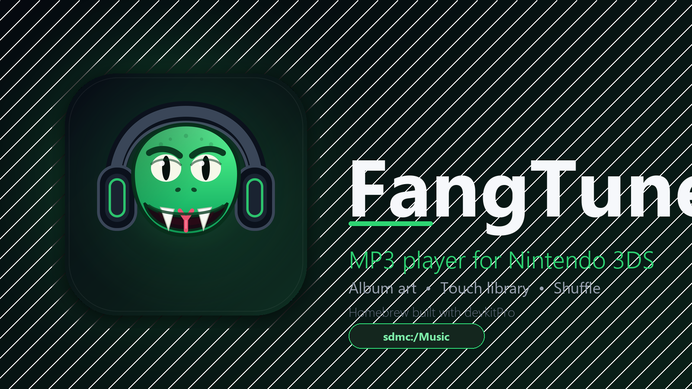
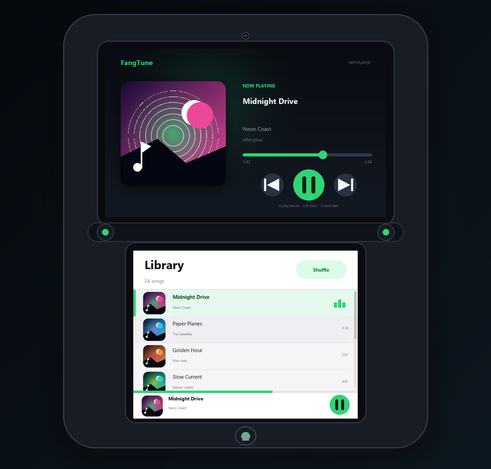
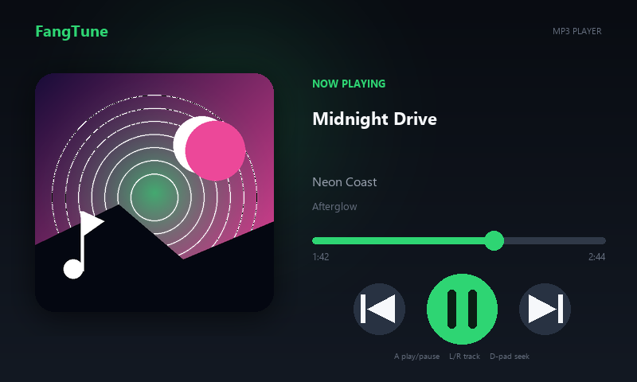
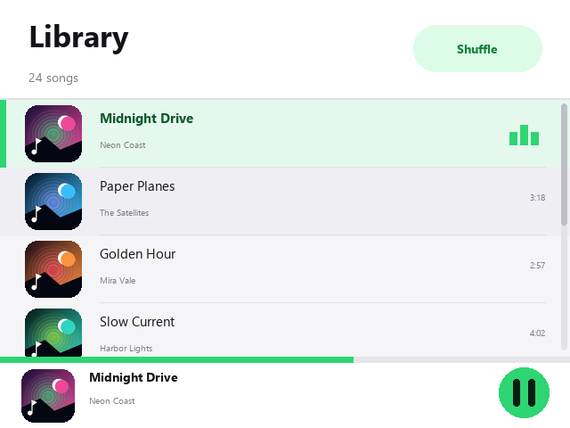

<p align="center">
  
</p>

<h1 align="center">FangTune</h1>

<p align="center">
  A tiny, opinionated MP3 player for the Nintendo 3DS.<br>
  It scans your music, shows the album art, and stays out of your way.
</p>

<p align="center">
  
  
  
</p>

---

<p align="center">
  
</p>

FangTune has two screens and one job:

- **Top screen** — a Spotify/YouTube-inspired now-playing view with cover art,
  title, artist, album, elapsed time and a seekable progress bar.
- **Bottom screen** — an Apple Music-inspired library. No file browser, no
  folders, no settings maze. Just your music, a shuffle toggle and a mini-player.

The mascot is a snake that bit off more camera than it could chew. It is wearing
headphones, so it is probably fine.

## UI preview

Design mockups of the two screens (not hardware captures):

| Now playing | Library |
| --- | --- |
|  |  |

## Features

- Recursively scans `sdmc:/Music` (subfolders included) and MP3 files directly
  in the SD card root.
- Reads ID3v2.2, ID3v2.3 and ID3v2.4 tags, with ID3v1 as a fallback.
- Extracts embedded APIC/PIC cover art (JPEG and PNG) and renders it as a
  runtime swizzled 256×256 texture.
- Streams MP3 audio through NDSP with four queued wave buffers, so playback
  does not stutter while the decoder refills.
- Play, pause, previous, next, shuffle, seek, automatic next-track and
  end-of-track detection.
- Touch scrolling with momentum, tap a row to play, tap the mini-player to
  pause, tap the progress bar to seek.
- Rescan the SD card without restarting (SELECT).
- Falls back to a clean, usable UI even when the DSP firmware is missing.

## Install

1. Download `fangtune.3dsx` from the [Releases](../../releases) page (or build
   it yourself, see below).
2. Copy it to your SD card:

   ```text
   sdmc:/3ds/fangtune.3dsx
   ```

3. Copy your MP3 files to:

   ```text
   sdmc:/Music/
   ```

   Subfolders work. MP3 files placed directly in the SD card root are picked up
   too.

4. Launch **FangTune** from the Homebrew Launcher.

### Audio / DSP firmware

Homebrew audio on a real 3DS needs the DSP firmware dump at:

```text
sdmc:/3ds/dspfirm.cdc
```

If you use Luma3DS, open the Rosalina menu → **Miscellaneous options...** →
**Dump DSP firmware**, then copy the resulting file to that path. Without it,
FangTune still opens and browses your library, but playback is unavailable.
Citra uses HLE audio and does not need a real firmware dump.

## Controls

| Input | Action |
| --- | --- |
| **A** | Play / pause |
| **B** or **L** | Previous track (restart first if past 3 seconds) |
| **X** or **R** | Next track |
| **Y** | Toggle shuffle |
| **D-pad Up / Down** | Move the library selection |
| **D-pad Left / Right** | Seek −5 s / +5 s |
| **Touch a song row** | Play that song |
| **Touch mini-player** | Play / pause |
| **Tap the progress bar** | Seek |
| **Touch the Shuffle pill** | Toggle shuffle |
| **SELECT** | Rescan `sdmc:/Music` |
| **START** | Exit |

## Build

FangTune is a normal devkitPro/libctru 3DS homebrew project.

### Prerequisites

- [devkitPro](https://devkitpro.org/wiki/Getting_Started) with the `3ds-dev`
  package group installed.
- `make`.

On Windows, use the devkitPro MSYS2 shell. On Linux or macOS, use the devkitPro
pacman packages.

```bash
# Example: install the 3DS toolchain (inside the devkitPro environment)
pacman -S 3ds-dev
```

### Compile

```bash
git clone https://github.com/yourname/fangtune-3ds.git
cd fangtune-3ds
make
```

Outputs:

```text
fangtune.3dsx   # Homebrew Launcher executable
fangtune.smdh   # icon / title metadata
fangtune.elf    # unstripped ELF for debugging
```

`make clean` removes the build directory and outputs.

### CI

`.github/workflows/build.yml` builds the project in the official devkitPro
container and uploads the `.3dsx` and `.smdh` as workflow artifacts.

## Project layout

```text
.
├── assets/               # icon source render + SMDH icon (48×48)
├── docs/                 # banner, UI mockups and device preview
├── include/
│   ├── app.h             # application state and high-level actions
│   ├── audio.h           # NDSP streaming player
│   ├── cover.h           # cover art decode + GPU upload
│   ├── id3.h             # ID3 / MPEG probing
│   ├── library.h         # SD card scanner
│   ├── types.h           # Song model and string helpers
│   ├── ui.h              # citro2d screens and input
│   ├── dr_mp3.h          # vendored MP3 decoder
│   └── stb_image.h       # vendored image decoder
├── source/
│   ├── main.cpp          # init, main loop, input repeat
│   ├── app.cpp           # playback / library actions
│   ├── audio.cpp         # NDSP wave-buffer streaming
│   ├── cover.cpp         # JPEG/PNG → RGBA → Morton swizzle → C3D texture
│   ├── id3.cpp           # ID3v2.2/2.3/2.4, APIC, ID3v1, MPEG header probe
│   ├── library.cpp       # recursive directory walk + sorting
│   ├── ui.cpp            # top/bottom screen drawing and touch handling
│   └── util.cpp          # UTF-8 / time / filename helpers
├── tools/
│   ├── icon.svg          # mascot source artwork
│   └── make_assets.py    # regenerates icons, banner and screenshots
├── Makefile
├── LICENSE
└── THIRD_PARTY_NOTICES.md
```

## How it works

- **Decoding.** `dr_mp3` decodes MP3 frames to interleaved PCM16. The player
  keeps four 4096-frame wave buffers queued on NDSP channel 0. Finished
  buffers are refilled from the decoder; the channel format and sample rate
  follow the current file, so 44.1 kHz and 48 kHz files both work.
- **Seeking.** `drmp3_seek_to_pcm_frame` handles the decoder side. The player
  clears the NDSP queue, seeks, refills and resumes only if it was playing.
- **Metadata.** The scanner reads ID3v2 frames directly and keeps cover art as
  a byte range inside the MP3 instead of copying the image into memory. The
  image is only read and decoded when the track becomes current.
- **Textures.** `stb_image` decodes JPEG/PNG, the result is resized to
  256×256, Morton-swizzled in software, then uploaded with `C3D_TexUpload`.
- **No file browser.** The library is sorted by title, then artist. If you want
  a different order, rename your files or fix your tags; FangTune deliberately
  does not expose the filesystem.

## Known limitations

- MP3 only. No FLAC, Ogg, AAC or WAV yet.
- VBR files without a Xing/Info header use a bitrate-based duration estimate
  until playback starts. The progress bar corrects itself once the decoder
  reports the real length.
- Very large embedded cover art is decoded on the UI thread. A 256×256 target
  keeps the GPU texture small, but decoding a multi-megabyte JPEG can still
  take a moment on original hardware.
- No playlists, search, favourites or background playback yet.
- The UI is tuned for the standard 3DS screen sizes (400×240 top, 320×240
  bottom) and does not use the stereoscopic 3D slider.

## Credits

- [devkitPro](https://devkitpro.org/) for devkitARM, libctru, citro2d and
  citro3d.
- [David Reid](https://github.com/mackron) for `dr_mp3`.
- [Sean Barrett](https://github.com/nothings) and contributors for
  `stb_image`.
- The 3DS homebrew community for years of documentation and examples.

## License

FangTune is released under the MIT License. See [LICENSE](LICENSE).

Bundled third-party headers keep their own licenses; see
[THIRD_PARTY_NOTICES.md](THIRD_PARTY_NOTICES.md).
